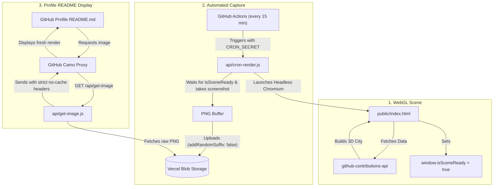

# GitHub 3D Contribution Visualizer

An automated, serverless 3D visualizer that turns your GitHub contribution graph into an isometric 3D city and serves it directly as an auto-updating image for your GitHub Profile README.


---

## Features

- **Isometric 3D Contribution Grid**: Renders your full year of contributions as 3D pillars with soft shadows, month/day labels, and pedestal staging in Three.js.
- **Automated Screenshot Cron**: A Vercel Cron function runs periodically, opens the 3D WebGL scene with a headless browser (`puppeteer-core` + `@sparticuz/chromium-min`), and takes a crisp screenshot.
- **Persistent Storage via Vercel Blob**: Saves the generated PNG into Vercel Blob storage with a stable URL.
- **GitHub Camo Cache-Busting Proxy**: Serves the image via `/api/get-image` with zero-cache HTTP headers (`max-age=0, no-cache, no-store, must-revalidate`), bypassing GitHub's aggressive Camo proxy caching so your profile always shows the newest render.
- **Customizable**: Query parameters allow changing the target username, year, and pillar height scaling.

---

## Architecture & How It Works



---

## Project Structure

```
├── .github/workflows/
│   └── trigger-render.yml # GitHub Actions workflow triggering the render every 15 min
├── api/
│   ├── cron-render.js    # Puppeteer cron job that captures the 3D scene & uploads to Blob
│   └── get-image.js      # Serverless proxy that serves the image with anti-cache headers
├── public/
│   └── index.html        # Pure Three.js WebGL 3D contribution visualizer
├── package.json          # Node.js dependencies (Puppeteer, Chromium, Vercel Blob)
├── vercel.json           # CORS header configuration
└── README.md             # Project documentation
```

---

## Setup & Deployment Guide

### 1. Clone & Install Dependencies

```bash
git clone https://github.com/<your-username>/github-3d-contribs.git
cd github-3d-contribs
npm install
```

### 2. Configure Your Default Username

In [`public/index.html`](file:///home/kaddulive/Desktop/Projects/github-3d-contribs/public/index.html):
```javascript
let currentUsername = urlParams.get('username') || urlParams.get('user') || '<YOUR_GITHUB_USERNAME>';
```

### 3. Deploy to Vercel

1. Push your repository to GitHub.
2. Import the repository in [Vercel](https://vercel.com).
3. In your Vercel Project Dashboard:
   - Navigate to the **Storage** tab.
   - Click **Create Database** and select **Blob**.
   - Connect the Blob Store to your project. This automatically injects `BLOB_READ_WRITE_TOKEN`.
4. Copy your **Blob Store ID** (found in your Vercel Blob store dashboard URL or settings) and add it as an Environment Variable:
   - Key: `VERCEL_BLOB_STORE_ID`
   - Value: `<your-store-id>`

---

## Embedding in Your GitHub Profile

Add this markdown snippet to your GitHub Profile `README.md`:

```markdown

```

*(Replace `your-vercel-domain.vercel.app` with your actual deployed Vercel domain)*

---

## URL Query Parameters (Interactive Preview)

You can preview the 3D scene directly in your browser with dynamic settings:

`https://your-vercel-domain.vercel.app/index.html?username=torvalds&multiplier=0.45`

| Parameter | Type | Default | Description |
| :--- | :--- | :--- | :--- |
| `username` / `user` | `string` | `LazyKaddu` | GitHub username to display |
| `year` | `string` | `last` | Target year or `last` for rolling 365 days |
| `multiplier` | `float` | `0.38` | Height multiplier scaling pillar heights |

---

## Technical Highlights

### Why `/api/get-image` is Needed
GitHub routes external images through an anonymizing caching proxy called **Camo**. Camo aggressively caches images for long periods, which prevents dynamic images from updating. 

[`api/get-image.js`](file:///home/kaddulive/Desktop/Projects/github-3d-contribs/api/get-image.js) sets the following headers:
```http
Cache-Control: max-age=0, no-cache, no-store, must-revalidate
Pragma: no-cache
Expires: 0
Content-Type: image/png
```
This forces GitHub Camo to request the fresh screenshot directly from your server on every profile view.

### Serverless WebGL Screenshotting
`api/cron-render.js` utilizes `@sparticuz/chromium-min` with `--enable-webgl` enabled to render full Three.js GPU shaders in AWS Lambda / Vercel Serverless environment, completing in ~3-5 seconds.

---

## License

This project is licensed under the [ISC License](file:///home/kaddulive/Desktop/Projects/github-3d-contribs/LICENSE).
